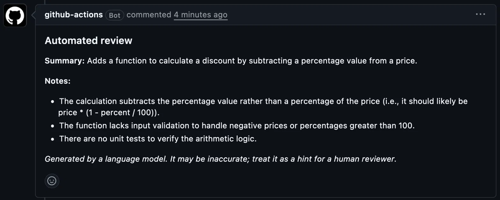

# pr-review-bot

A small Python service that asks an LLM (Google Gemini API) to summarize a pull request diff and point out possible issues. The model is asked to reply in a fixed JSON shape, and the code validates the reply and retries once if it is malformed.

Status: work in progress.

## What works now
- `reviewer.py`: `summarize_diff(diff)` sends a git diff to the model and returns `{"summary": ..., "notes": [...]}`
- Output validation (valid JSON, required fields, 1 to 3 notes) with one automatic retry
- Unit tests that run without calling the real API (`pytest`)
- HTTP service with FastAPI: `GET /health` and `POST /review`
- Docker image (the API key is passed at runtime, not baked into the image)
- CI workflow that runs the tests on push and pull request
- GitHub Actions workflow that runs the reviewer on pull requests and posts the result as a comment

## Run it
```bash
python3 -m venv .venv
source .venv/bin/activate
pip install -r requirements.txt
echo "GEMINI_API_KEY=your-key" > .env
python try_call.py samples/diff1.diff
python -m pytest -q
```

Run the HTTP service:
```bash
uvicorn app:app --port 8000
curl http://localhost:8000/health
```

Run with Docker:
```bash
docker build -t pr-review-bot .
docker run --env-file .env -p 8000:8000 pr-review-bot
```

## Demo
On a test pull request with a deliberate bug (`apply_discount` subtracted `percent / 100` instead of a percentage of the price), the bot flagged the wrong formula, the missing input validation and the missing tests.



The workflow is `.github/workflows/pr-review.yml`. It needs a `GEMINI_API_KEY` repository secret, and it skips pull requests from forks so the secret is not exposed.

## Not done yet
- Kubernetes (minikube) deployment
- A larger set of sample diffs to evaluate prompt changes

## Notes
- The API key is read from the environment or a local `.env` file, which is not committed.
- Sample diffs are short and written for testing only.
- Tested on a handful of examples only. The output comes from a language model and can be inaccurate, so treat it as a hint for a human reviewer, not a verdict.
- The free Gemini tier may use submitted content to improve Google products, so only use this on public or your own code.
- Problems met during development are in `NOTES.md`.